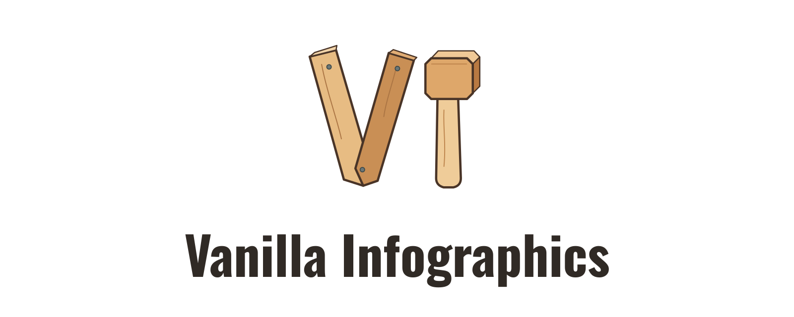
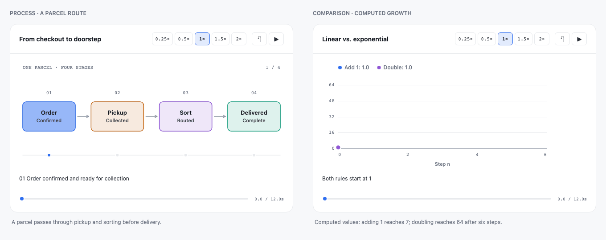
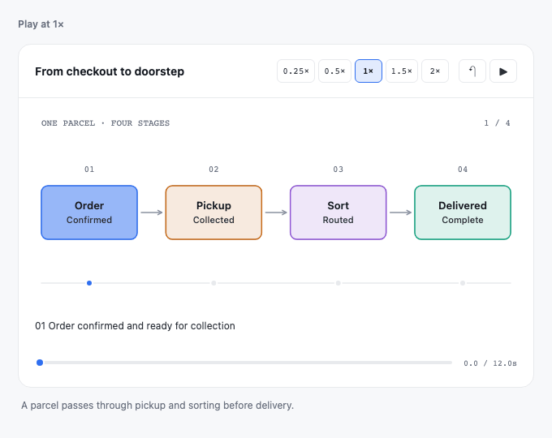

<p align="center">
  
</p>
<p align="center">An agent skill for clear, animated infographics in plain JavaScript.</p>
<p align="center">Codex · Claude Code · Canvas 2D · Zero runtime dependencies</p>
<p align="center"><a href="https://github.com/asn6878/vanilla-diagram/releases/tag/v0.0.1"></a> <a href="LICENSE"></a></p>
<p align="center"><a href="#get-started">Get started</a> · <a href="SKILL.md">The skill</a> · <a href="docs/README.ko.md">한국어</a></p>

Describe a process, a comparison, or an idea that changes over time. Your agent builds a small, editable infographic with speed controls, pause, reverse playback, and a timeline you can scrub.

### Customize in natural language

Describe your own layout, visual style, colors, labels, and motion. Ask for a radial flow, a branching diagram, a vertical timeline, or a custom composition, then refine it with follow-up requests. Your agent writes the drawing code to match; the surrounding HTML and CSS are editable too. The examples below are starting points.

## Examples

Two different explanations, using the same player: a parcel's route and a computed growth comparison.



Individual clips: [parcel route](docs/media/parcel-route.gif) · [growth curves](docs/media/growth-curves.gif). Their source is in [examples/scenes/](examples/scenes/).

## Take control

Change speed, pause on a detail, drag forward and backward, or play the explanation in reverse.

<p align="center"></p>

## Get started

Clone the repository and install the skill for your agent. Node.js 22+ is used by the helper scripts.

```bash
git clone https://github.com/asn6878/vanilla-diagram.git
cd vanilla-diagram

# Pick one, or use --agent all.
node scripts/install.mjs --agent codex
node scripts/install.mjs --agent claude
```

| Agent docs | Personal installation | Project installation | Invoke |
| --- | --- | --- | --- |
| [Codex](https://learn.chatgpt.com/docs/build-skills) | `~/.agents/skills/vanilla-diagram` | `.agents/skills/vanilla-diagram` | `$vanilla-diagram` |
| [Claude Code](https://code.claude.com/docs/en/skills) | `~/.claude/skills/vanilla-diagram` | `.claude/skills/vanilla-diagram` | `/vanilla-diagram` |

For a project installation, add `--project /path/to/your/project`. The installer copies the skill and its supporting files; `--force` replaces an existing installation.

The agent links above lead to official documentation. Run the commands to install, then invoke the skill in your agent. If it does not appear, restart the agent. The bundled installer does not require `npm install`.

<details>
<summary>Install with the Skills CLI instead</summary>

The [Skills CLI](https://github.com/vercel-labs/skills) also supports this repository:

```bash
npx skills add asn6878/vanilla-diagram --skill vanilla-diagram --agent codex --global
npx skills add asn6878/vanilla-diagram --skill vanilla-diagram --agent claude-code --global
```

Omit `--global` to install into your current project. This route copies the repository documentation and demos along with the skill.

</details>

Prefer a download? Get the [0.0.1 skill ZIP](https://github.com/asn6878/vanilla-diagram/releases/download/v0.0.1/vanilla-diagram-skill-v0.0.1.zip) and extract its `vanilla-diagram` folder into your agent’s skills directory.

Try a prompt:

```text
Use vanilla-diagram to explain how an application reads from a cache or a database.
Place the application in the center, with the cache and database as two branches.
Use a dark background, teal and amber accents, and short labels.
Animate cache hits and misses separately, with a vertical layout on phones.
```

Then refine it: "Make the labels larger, replace the boxes with circles, and slow down the cache-miss sequence."

Or open the included examples without installing anything:

```bash
npm run dev
# http://localhost:4310/examples/
```

The output is ordinary HTML, CSS, and ES modules. Edit `scene.js`; the shared player handles controls, resizing, themes, and reduced motion. See the [design guide](references/design.md) and [API reference](references/api.md) for details.

## Stack

Vanilla JavaScript · HTML · CSS · Canvas 2D. Node.js runs the local tools. Playwright and FFmpeg are used only to record the README GIFs.

To regenerate the recordings: `npm install`, `npx playwright install chromium`, install FFmpeg, then `npm run capture`.
To record only the controls demo, use `npm run capture -- --controls-only`.

## License

[MIT](LICENSE). The bundled Oswald font is covered by its [SIL Open Font License](docs/brand/fonts/OFL.txt).
